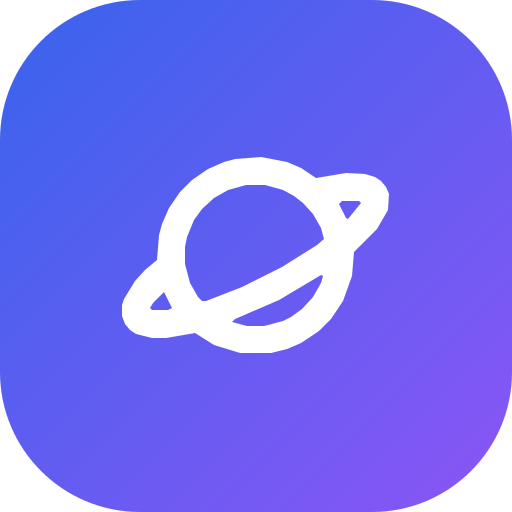

<div align="center">

<picture>
  <source media="(prefers-color-scheme: dark)" srcset="logo-white.svg">
  
</picture>

# CPA Manager Plus

[](https://github.com/seakee/CPA-Manager-Plus/releases/latest)
[](https://github.com/seakee/CPA-Manager-Plus/blob/main/LICENSE)
[](https://hub.docker.com/r/seakee/cpa-manager-plus)
[](https://github.com/seakee/CPA-Manager-Plus/stargazers)

リクエスト、使用量、コスト、クォータ、障害、アカウントの健全性を把握できる、セルフホスト型の CPA / CLIProxyAPI 管理パネル兼 AI ゲートウェイ可観測性ダッシュボードです。

プロバイダー、認証情報、OAuth、プラグイン、設定を操作しながら、永続的なリクエスト履歴、コスト分析、アカウントの自動化をローカルストレージに保持できます。

[English](README.md) ｜ [中文](README_CN.md) ｜ [ライブデモ](https://cpamp-demo.seakee.dev/) ｜ [ドキュメント](https://cpamp-docs.seakee.dev/en/) ｜ [ホームページ](https://cpamp.seakee.dev/) ｜ [インストール](#クイックスタート)

</div>

## スポンサー

<small>スポンサー掲載 · アフィリエイトリンク</small>

<table>
  <tr>
    <td width="128" align="center" valign="middle"><a href="https://infistar.cc/register?aff=PC3AZUBX&amp;ref_source=link" target="_blank" rel="noopener noreferrer"></a></td>
    <td valign="middle"><p><a href="https://infistar.cc/register?aff=PC3AZUBX&amp;ref_source=link" target="_blank" rel="noopener noreferrer">Infistar.cc</a>: 1 つの API キーで Claude、GPT、Gemini、DeepSeek などにアクセスでき、料金は公式価格の最大 1% まで抑えられます。100% 本物のモデルを、1,000 以上の冗長ルートと自動フェイルオーバーで提供します。CPAMP ユーザーは専用リンクから登録すると、5 人民元分の無料クレジットを受け取れます。</p></td>
  </tr>
</table>

<sub><strong>免責事項:</strong> スポンサー情報および宣伝上の主張はスポンサーが提供したものです。このセクションにはアフィリエイトリンクが含まれます。CPAMP は、スポンサーのサービス、製品品質、セキュリティ、信頼性、または宣伝内容について一切保証しません。スポンサーシップは CPAMP による推奨や認定を意味するものではありません。</sub>

## CPAMP で答えられる疑問

- **リクエストが失敗するのはなぜか？** 永続的なリクエスト履歴で、失敗率、ステータスコード、影響を受けたモデル/アカウント、秘匿化されたエビデンスを確認できます。
- **コストはどこに使われているか？** トークンと推定コストを、モデル、プロバイダー、アカウント、API キー、プロジェクト、チャネル、期間別に分析できます。
- **アカウントとクォータは健全か？** Codex と xAI のアカウントについて、認証情報の状態、クォータウィンドウ、リセットのエビデンス、制御された自動化を確認できます。

## スクリーンショット

<table>
  <tr>
    <td align="center">
      <strong>ダッシュボード</strong><br>
      
    </td>
    <td align="center">
      <strong>リクエスト監視</strong><br>
      
    </td>
  </tr>
  <tr>
    <td align="center">
      <strong>使用量分析</strong><br>
      
    </td>
    <td align="center">
      <strong>認証情報リスト</strong><br>
      
    </td>
  </tr>
  <tr>
    <td align="center">
      <strong>認証情報カード</strong><br>
      
    </td>
    <td align="center">
      <strong>認証情報の詳細</strong><br>
      
    </td>
  </tr>
  <tr>
    <td align="center">
      <strong>認証情報のヘルスチェック</strong><br>
      
    </td>
    <td align="center">
      <strong>認証情報のクォータ</strong><br>
      
    </td>
  </tr>
</table>

## どのパネルを選ぶべきか

CPA / CLIProxyAPI は、公式の Management Center と CPAMP Lightweight Panel のどちらも `:8317` で直接配信できます。Lightweight Panel は、サービスを追加することなく公式 UI を置き換えます。永続的な可観測性と長時間稼働する運用も必要な場合は、CPAMP Full Mode をデプロイしてください。

| 選択肢                                                                                                       | 適した用途                                                  | エントリー                              |
| ------------------------------------------------------------------------------------------------------------ | ----------------------------------------------------------- | --------------------------------------- |
| 公式の [CLI Proxy API Management Center](https://github.com/router-for-me/Cli-Proxy-API-Management-Center) | CPA プロジェクトが保守するアップストリームの UI を使い続けたい場合 | CPA `:8317/management.html`             |
| CPAMP Lightweight Panel                                                                                      | 別のサービスやデータベースを追加せず、UI だけを置き換えたい場合 | CPA `:8317/management.html`             |
| CPAMP Full Mode                                                                                              | リクエスト履歴、コスト分析、ヘルスチェック、自動化            | Manager Server `:18317/management.html` |

比較については [Choosing A CPA Panel](https://cpamp-docs.seakee.dev/en/guide/choosing-a-panel.html) を参照するか、CPA に直接 [CPAMP Lightweight Panel をインストール](https://cpamp-docs.seakee.dev/en/deployment/cpa-panel.html)してください。

## 主な機能

### CPA ゲートウェイ管理

- Gemini、Codex、Claude、Vertex、xAI、Devin、Muse / Meta、OpenAI 互換プロバイダーなど、CPA のプロバイダー設定を管理できます。
- 認証ファイル、OAuth ログイン、API キー、モデルエイリアス、優先度、プラグイン、ログ、システム設定を管理できます。Muse / Meta は、`meta-api-key` 推論プロバイダーとは別に Device Flow の認証情報をサポートします。
- Sub2API 公式の OpenAI OAuth エクスポートをインポートし、複数のアカウントを個別の CPA Codex 認証ファイルに分割できます。

### リクエスト監視と障害診断

- CPA 使用量キューのリクエストをローカルの SQLite に永続化し、アカウント、クライアント API キー、リアルタイムのリクエストビューを検索できます。
- 生の失敗レスポンス本文を公開することなく、ステータス、レイテンシ、トークン、キャッシュ、トレース、秘匿化された失敗のエビデンスを確認できます。
- リクエスト履歴を JSONL としてエクスポートまたはインポートできます。
- [監視デモ](https://cpamp-demo.seakee.dev/#/demo/monitoring)を開く。

### コストと使用量の分析

- 呼び出し数、トークン、コスト、レイテンシ、失敗を、モデル、プロバイダー、アカウント、認証情報、API キー、プロジェクト、チャネル、期間別に分析できます。
- 入力、出力、推論、キャッシュ、サービスティア、ロングコンテキストの料金体系を追跡できます。
- モデル価格はまず models.dev から同期し、LiteLLM と OpenRouter をフォールバックとして使用します。エイリアスや内部モデル向けにローカルでの上書きも可能です。
- [使用量分析デモ](https://cpamp-demo.seakee.dev/#/demo/usage-analytics)を開く。

### アカウントの健全性、クォータ、自動化

- Codex と xAI のアカウントを、ローカルで、または Manager Server のスケジュールでヘルスチェックできます。
- 利用可能な場合は、クォータウィンドウ、リセットのエビデンス、認証情報の状態、ワークスペースの状態、プロバイダー固有の健全性シグナルを読み取ります。
- 制御されたクォータクールダウンを適用し、認証情報の失敗をアカウントアクションキューに送ってレビューと復旧を行えます。
- 統合された[アカウントデモ](https://cpamp-demo.seakee.dev/#/demo/accounts)を開く。

### 本番運用

- CPAMP Full Mode は、1 つの Docker コンテナとして、または amd64/arm64 向けのネイティブ Linux、macOS、Windows パッケージとして実行できます。フルスタックを CPA と並行して実行することも可能です。
- リクエスト履歴、Manager の設定、自動化の状態、モデル価格をローカルファイルに保持し、アカウント登録やテレメトリ SDK は不要です。
- 暗号化された CPA Management Key を保持するため、SQLite ファイルは `data.key` と一緒にバックアップしてください。
- 読み取り専用のルートファイルシステムや非 root ユーザーでランタイムを堅牢化する場合は、SQLite に書き込み可能な一時ディレクトリと書き込み可能なデータベースファイルを用意してください。詳しくは [Read-Only Root Filesystem](https://cpamp-docs.seakee.dev/en/deployment/docker.html) を参照してください。

まずインターフェースを確認したい場合は、[ライブデモ](https://cpamp-demo.seakee.dev/)を開いてください。デモでは架空のデータのみを使用しています。デモはデプロイやランタイムのモードではなく、実際の CPA インスタンスへの接続、管理、監視はできません。

CPAMP は CPA / CLIProxyAPI を通じてトラフィックを管理・監視します。代替のプロキシではなく、CPAMP 自体がモデルのトラフィックを転送することはありません。

## クイックスタート

### インストーラー

ガイド付きでフルスタックまたは CPAMP のみをデプロイする場合:

```bash
curl -fsSLO https://raw.githubusercontent.com/seakee/CPA-Manager-Plus/main/bin/install-cpamp.sh
bash install-cpamp.sh
```

デプロイせずにプレビューする場合:

```bash
CPAMP_DRY_RUN=1 bash install-cpamp.sh
```

アップグレード、修復、管理者キーの復旧時の動作については [One-Click Installer](https://cpamp-docs.seakee.dev/en/deployment/installer.html) を参照してください。

### CPA と CPAMP を併せて使う

```yaml
services:
  cli-proxy-api:
    image: eceasy/cli-proxy-api:latest
    restart: unless-stopped
    ports:
      - '8317:8317'
    volumes:
      - cpa-data:/app/data

  cpa-manager-plus:
    image: seakee/cpa-manager-plus:latest
    restart: unless-stopped
    ports:
      - '18317:18317'
    volumes:
      - cpa-manager-plus-data:/data

volumes:
  cpa-data:
  cpa-manager-plus-data:
```

```bash
docker compose up -d
```

`http://<host>:18317/management.html` を開き、Manager Server のログから CPAMP Admin Key を取得したうえで、セットアップ中に CPA の URL と CPA Management Key を入力してください。

### CPAMP のみ

CPA がすでに稼働している場合:

```bash
docker run -d \
  --name cpa-manager-plus \
  --restart unless-stopped \
  -p 18317:18317 \
  -v cpa-manager-plus-data:/data \
  seakee/cpa-manager-plus:latest
```

推奨 CPA バージョン: `v7.3.4+`。HTTP 使用量キューには `v6.10.8+` が必要です。

## ドキュメント

| タスク                                                    | ガイド                                                                                                                                                                                                                                                                     |
| --------------------------------------------------------- | -------------------------------------------------------------------------------------------------------------------------------------------------------------------------------------------------------------------------------------------------------------------------- |
| 適切なパネルとデプロイモードを選ぶ                        | [Choosing A CPA Panel](https://cpamp-docs.seakee.dev/en/guide/choosing-a-panel.html)                                                                                                                                                                      |
| 別のサービスをデプロイせずに公式 UI を置き換える          | [CPAMP Lightweight Panel](https://cpamp-docs.seakee.dev/en/deployment/cpa-panel.html)                                                                                                                                                                     |
| インストールして初期セットアップを完了する                | [Getting Started](https://cpamp-docs.seakee.dev/en/guide/getting-started.html)                                                                                                                                                                            |
| サポートされている機能とモードを理解する                  | [Capability Matrix](https://cpamp-docs.seakee.dev/en/reference/capability-matrix.html)                                                                                                                                                                    |
| ランタイムのポート、キー、リクエストフローを理解する      | [Runtime Model](https://cpamp-docs.seakee.dev/en/guide/runtime-model.html)                                                                                                                                                                                |
| プロバイダー、認証情報、クォータ、プラグインを設定する    | [AI Providers](https://cpamp-docs.seakee.dev/en/manual/ai-providers.html), [Accounts](https://cpamp-docs.seakee.dev/en/manual/accounts.html), [Plugin Management](https://cpamp-docs.seakee.dev/en/manual/plugins.html) |
| Manager Server、バックアップ、アップグレード、移行を運用する | [Manager Server Guide](https://cpamp-docs.seakee.dev/en/operations/manager-server.html)                                                                                                                                                                   |
| データをバックアップする、または紛失した管理者キーを復旧する | [Backup And Restore](https://cpamp-docs.seakee.dev/en/operations/backup.html), [Reset Admin Key](https://cpamp-docs.seakee.dev/en/operations/reset-admin-key.html)                                                                       |
| 旧 CPA-Manager から移行する                               | [Migration From CPA-Manager](https://cpamp-docs.seakee.dev/en/migration/from-cpa-manager.html)                                                                                                                                                            |
| 監視が空になる問題やキューの問題を診断する                | [Troubleshooting](https://cpamp-docs.seakee.dev/en/troubleshooting/request-monitoring.html)                                                                                                                                                               |

## データ、プライバシー、セキュリティ

- CPAMP は外部へのデータ送信 (phone home) を行わず、分析 SDK も含まず、アカウント登録も不要です。
- 外部への通信は、CPA ゲートウェイと、OAuth、プロバイダーチェック、プラグインのリリース、モデル価格の同期など、明示的に設定またはトリガーした連携に限られます。
- リクエスト履歴、設定、モデル価格、ヘルスチェック履歴、自動化の状態はローカルファイルに保持されます。
- CPA Management Key は SQLite に永続化される前に暗号化されます。バックアップには SQLite ファイルと `data.key` が必要です。
- 通常の API と JSONL エクスポートでは秘匿化された失敗の概要のみが公開され、生の失敗レスポンス本文や保存された生の JSON が公開されることはありません。
- CPAMP は、運用する権限を持つトラフィックと認証情報に対して使用することを想定しています。
- セキュリティ脆弱性の疑いがある場合は、[非公開で報告](https://github.com/seakee/CPA-Manager-Plus/security/advisories/new)し、[セキュリティポリシー](SECURITY.md)に従ってください。修正されていないエクスプロイトの詳細を公開の Issue で開示しないでください。

## 開発

```bash
npm install
npm run dev
npm run type-check
npm run lint
npm run test
npm run build
```

ドキュメントサイトは
[`cpamp-hq/docs`](https://github.com/cpamp-hq/docs) (1.x → `main`、v2 → `next`) にあります。
ビルドはそちらで `npm install && npm run docs:build` を実行してください。

Manager Server:

```bash
cd apps/manager-server
go test ./...
go test -race ./...
go vet ./...
go run ./cmd/cpa-manager-plus
```

Docker スタックをローカルでビルドする場合:

```bash
docker compose -f docker-compose.manager.yml up --build
```

## リリース

- `npm run build` は単一ファイルの `apps/web/dist/index.html` を作成します。
- `bin/release/package-native.sh` はパネルをネイティブパッケージに埋め込みます。
- リリースノートは `release/<version> -> dev -> main` の流れで作成し、検証済みの `main` へのプロモーションマージから、
  厳密な `vX.Y.Z` タグまたはプレリリースタグをプッシュします。
- `npm run release:validate -- --tag <tag> --content-only` は、タグを作成する前に
  必須の 3 つのリリースファイルをチェックします。
- `.github/workflows/release.yml` は `main` からの `workflow_dispatch` によるドライランを提供します。
  GitHub Release、コンテナイメージ、Telegram メッセージを公開せずに検証とビルドを行います。
- リリースアセットには、`management.html`、ネイティブパッケージ、`linux/amd64` と `linux/arm64` 向けの Docker イメージが含まれます。
- リリースの公開は直列化されており、コミットログへの自動フォールバックはありません。
  リリースノートが欠落または不一致の場合は安全側に倒して失敗します。復旧手順と必要なリポジトリ保護については
  [`docs/release.md`](docs/release.md) を参照してください。

## 謝辞

- ランタイムと WebUI の基盤を提供してくれた [CLIProxyAPI](https://github.com/router-for-me/CLIProxyAPI) と公式の [CLI Proxy API Management Center](https://github.com/router-for-me/Cli-Proxy-API-Management-Center) に感謝します。
- プロジェクトの宣伝とフィードバックに協力してくれた [Linux.do](https://linux.do/) コミュニティに感謝します。

## ライセンス

[MIT](https://github.com/seakee/CPA-Manager-Plus/blob/main/LICENSE) — Copyright 2026 Seakee.
