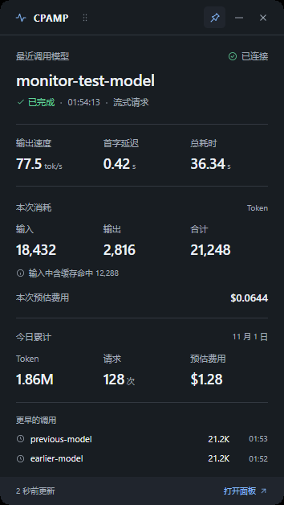
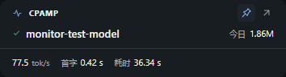

# Native Packages

Use native packages when Docker is not part of your environment. They fit deployments already managed by systemd, launchd, Windows services, or another process supervisor.

Native mode is still Manager Server mode: the binary serves `/management.html`, stores SQLite data locally, and uses the CPAMP Admin Key for login. It is not the old "external Usage Service for the CPA-port panel" workflow.

If you only want to install the CPAMP native package, you can use [One-Click Installer](./installer.md). The script does not install CPA natively; use Docker for a full new deployment.

## Shortest Installation Path

1. Confirm that CPA already runs and prepare its URL and CPA Management Key.
2. Download the native package for your operating system and architecture from GitHub Releases.
3. Extract and run `cpa-manager-plus`, or use the included background control script.
4. Open `http://<host>:18317/management.html`.
5. Log in with the generated CPAMP Admin Key from the logs and connect CPA.

For long-running production use, choose systemd, launchd, Windows Service Manager, or another process manager afterward.

## Windows Floating Monitor

Windows amd64/arm64 packages also include `cpa-manager-plus-monitor.exe`. This is an independent read-only desktop client, not another Manager Server, collector, proxy or database reader. Keep Manager running separately; closing the monitor does not stop Manager or CPA.

```powershell
.\cpa-manager-plus-monitor.exe --url http://127.0.0.1:18317 --lang en
```





`--url` is a **Manager** base URL, not the CPA gateway or a `management.html` URL. Reverse-proxy prefixes are preserved, for example `https://HOST/cpamp`. Loopback HTTP or any HTTPS host is accepted. A remote Manager that only serves plain HTTP can be used only after ticking the explicit **Allow remote plain HTTP** option, which sends the admin key unencrypted. URL credentials, queries, fragments and ambiguous paths are rejected. `--lang en` and `--lang zh` select English/Chinese. Enter the **CPAMP Admin Key** in the native password edit. There is no key command-line flag, environment variable or URL parameter.

### Display and controls

- Drag the CPAMP header to move. Pin toggles the real Windows topmost flag. Compact/Expand switches between the small bar and full accounting view. The window adapts to per-monitor DPI and clamps saved positions into the nearest work area after display changes.
- Expanded: latest recorded request model, completion/failure status and time; input, output, cache-hit and total tokens; estimated request cost; local-day calls/tokens/cost; output speed, streaming TTFT and duration; two earlier requests.
- The window embeds the exact approved HTML/CSS/SVG in Microsoft Edge WebView2 rather than approximating it with GDI. Expanded is 354 × 628 CSS pixels; compact is 354 × 96 CSS pixels. Windows 11 normally includes WebView2 Runtime; install the Microsoft runtime if it is missing.
- Compact: model, today tokens, output speed, TTFT and duration, plus connection/update status. Expand for full accounting/history. Compact is intentionally not a live token-stream progress view.
- Hide keeps a notification-area icon and pauses/cancels network work. Click or right-click the icon to restore and immediately refresh. Close exits the companion and cancels/joins its worker. Connection edits pause polling; Cancel keeps the old connection. Open panel launches the validated base plus `/management.html` in your browser **without** the key.
- Visible controls and the password form use WebView2 accessibility and keyboard navigation. Click the CPAMP brand or connection status to open settings; use the tray to hide. Native command boundaries remain available for compatibility automation. Window class: `CPAMPFloatingMonitorWindow`. Button IDs: Pin 101, Compact 102, Hide 103, Close 104, Connection 105, Open panel 106. Form IDs: URL 201, password 202, Remember checkbox 203, Connect 204, Cancel 205. Metric IDs: status 301, model 302, request 303, speed 304, TTFT 305, duration 306, tokens 307, request cost 308, today 309, history 310/311, update time 312. Use normal Win32 messages; no production screenshot/test backdoor exists.

### Telemetry and estimates

Polling is serialized outside the UI thread (three seconds after a completed fetch), with cancellation on hide, reconnect, authorization loss or close. Each HTTP call has a 12-second timeout; a complete poll has a 20-second deadline and each response a 2 MiB limit. Redirects are rejected, including same-origin redirects. Network/status/JSON errors never echo response bodies or keys.

Today's totals come from `/v0/management/dashboard/summary` using local midnight and the current instant. Midnight/DST resets today's values to unknown until refreshed; the last request does not disappear at midnight. Recent history is a separate 30-calendar-day analytics query with `events_page.limit=3` and unnecessary aggregate flags disabled. History can be incomplete after retention/archive deletion; the UI labels a server-reported partial history.

Output speed follows CPAMP monitoring: **output tokens / full request latency**, including first-token waiting. It is a duration-average output rate, not an observed generation-only rate. It deliberately does not subtract TTFT as the illustrative design mockup did. TTFT is displayed only for confirmed streaming records with a positive measurement; nonstreaming, zero, invalid and absent TTFT are unknown. Duration and token zero values remain legitimate measured zeros; missing/invalid values show `—`. Cache hits are already included in normalized input and are not added to total a second time.

Request estimates reuse the Manager's `internal/service/pricing` engine and model-prices endpoint, including model resolution, context bands, cache buckets and service tiers. Missing prices/cost remain unknown, not invented free requests. Explicit zero/free prices remain zero. Today's cost is the dashboard's estimate, not a recomputation from three recent requests. A transient error retains same-connection last-good data with offline/update labels; reconnect clears old scope and authorization loss clears all telemetry and removes the remembered key.

### Local settings and cleanup

Only base URL, position, compact and pin preferences are saved in `%LOCALAPPDATA%\CPA-Manager-Plus\monitor\preferences.json`. Remember is off by default. When selected, a separate `key.dpapi` contains current-user DPAPI ciphertext bound to the normalized Manager URL. The directory and files use protected current-user/SYSTEM DACLs rather than relying on Unix permission bits. Changing the URL never reuses a key saved for another Manager. Uncheck Remember and connect to remove saved ciphertext. A decryption/corruption error requests a new key rather than forwarding invalid credentials. No account identity, request body, raw event metadata or usage database is persisted by the monitor.

After closing the monitor, remove only `%LOCALAPPDATA%\CPA-Manager-Plus\monitor` to reset its preferences and key. Do not delete Manager's data/config directories. Default Go strings are not a secure-memory facility: an entered key necessarily exists in process memory while authenticated.

### Build and focused tests

From the repository root (Git Bash/Linux/macOS), no frontend build or CGO is required for the monitor alone:

```bash
cd apps/manager-server
go test ./internal/desktopmonitor ./internal/service/pricing
CGO_ENABLED=0 GOOS=windows GOARCH=amd64 go build -trimpath -ldflags '-s -w -H windowsgui' -o cpa-manager-plus-monitor.exe ./cmd/cpa-manager-plus-monitor
CGO_ENABLED=0 GOOS=windows GOARCH=arm64 go build -trimpath -ldflags '-s -w -H windowsgui' -o cpa-manager-plus-monitor-arm64.exe ./cmd/cpa-manager-plus-monitor
```

Portable HTTP/model tests run on other OSes. Native controls/lifecycle, preferences, Windows DACL and DPAPI tests execute on Windows with temporary stores and controlled HTTP fixtures, not real Manager data. The focused Windows Floating Monitor CI workflow tests these packages and cross-builds both architectures. `bin/release/package-native.sh` adds the GUI only to Windows archives; it leaves other platforms unchanged. The package contract can be checked with `npx vitest run tests/nativeMonitorPackage.test.mjs`.

## Requirements

Before running it, prepare:

- CPA / CLI Proxy API running separately.
- CPA Management API enabled.
- A CPA Management Key.
- A persistent and backed-up CPAMP data directory.
- Exactly one CPAMP Manager Server consuming one CPA usage queue.

Recommended CPA version:

```text
v7.1.39+
```

Minimum for HTTP usage queue:

```text
v6.10.8+
```

## Download

Download the package for your platform from [GitHub Releases](https://github.com/seakee/CPA-Manager-Plus/releases/latest).

Common package names:

```text
cpa-manager-plus_<version>_linux_amd64.tar.gz
cpa-manager-plus_<version>_linux_arm64.tar.gz
cpa-manager-plus_<version>_darwin_amd64.tar.gz
cpa-manager-plus_<version>_darwin_arm64.tar.gz
cpa-manager-plus_<version>_windows_amd64.zip
cpa-manager-plus_<version>_windows_arm64.zip
```

Check Linux architecture:

```bash
uname -m
```

Mapping:

```text
x86_64  -> linux_amd64
aarch64 -> linux_arm64
arm64   -> linux_arm64
```

## Run Manually

macOS / Linux:

```bash
tar -xzf cpa-manager-plus_vX.Y.Z_linux_amd64.tar.gz
cd cpa-manager-plus_vX.Y.Z_linux_amd64
./cpa-manager-plus
```

Windows PowerShell:

```powershell
Expand-Archive .\cpa-manager-plus_vX.Y.Z_windows_amd64.zip -DestinationPath .
cd .\cpa-manager-plus_vX.Y.Z_windows_amd64
.\cpa-manager-plus.exe
```

Print the current binary version without starting Manager Server or reading its configuration or database:

```bash
./cpa-manager-plus --version
```

Windows PowerShell:

```powershell
.\cpa-manager-plus.exe --version
```

The short `-v` flag is also supported.

Open:

```text
http://<host>:18317/management.html
```

If no admin key is configured, the process prints a generated `cpamp_...` key once. Save it immediately.

You can also set it explicitly.

macOS / Linux:

```bash
CPA_MANAGER_ADMIN_KEY='replace-with-a-long-random-admin-key' ./cpa-manager-plus
```

Windows PowerShell:

```powershell
$env:CPA_MANAGER_ADMIN_KEY = 'replace-with-a-long-random-admin-key'
.\cpa-manager-plus.exe
```

## Data Location

By default, native packages create:

```text
config.json
data/usage.sqlite
data/data.key
```

next to the binary.

Override with:

```bash
USAGE_DATA_DIR=/var/lib/cpa-manager-plus ./cpa-manager-plus
```

or:

```bash
USAGE_DB_PATH=/var/lib/cpa-manager-plus/usage.sqlite ./cpa-manager-plus
```

Back up:

```text
data/usage.sqlite
data/usage.sqlite-wal
data/usage.sqlite-shm
data/data.key
```

`data.key` decrypts the saved CPA Management Key. If it is lost, save the CPA connection again.

::: details Advanced: Linux systemd example

## Linux systemd Example

Install to a fixed directory:

```bash
sudo mkdir -p /opt/cpa-manager-plus /var/lib/cpa-manager-plus
sudo cp -a cpa-manager-plus_vX.Y.Z_linux_amd64/* /opt/cpa-manager-plus/
sudo useradd --system --no-create-home --shell /usr/sbin/nologin cpa-manager-plus
sudo chown -R cpa-manager-plus:cpa-manager-plus /opt/cpa-manager-plus /var/lib/cpa-manager-plus
```

Create `/etc/systemd/system/cpa-manager-plus.service`:

```ini
[Unit]
Description=CPA Manager Plus Manager Server
After=network-online.target
Wants=network-online.target

[Service]
Type=simple
User=cpa-manager-plus
Group=cpa-manager-plus
WorkingDirectory=/opt/cpa-manager-plus
ExecStart=/opt/cpa-manager-plus/cpa-manager-plus
Restart=on-failure
RestartSec=3

Environment=HTTP_ADDR=0.0.0.0:18317
Environment=USAGE_DATA_DIR=/var/lib/cpa-manager-plus
# Recommended: provide a stable secret through an environment file or secret manager.
# Environment=CPA_MANAGER_ADMIN_KEY=replace-with-a-long-random-admin-key

[Install]
WantedBy=multi-user.target
```

Start:

```bash
sudo systemctl daemon-reload
sudo systemctl enable --now cpa-manager-plus
sudo systemctl status cpa-manager-plus
```

Logs:

```bash
journalctl -u cpa-manager-plus -f
```

:::

## First Setup

Open:

```text
http://<host>:18317/management.html
```

Enter:

```text
Admin Key:          cpamp_... from logs, or your configured admin key
CPA URL:            http://127.0.0.1:8317, http://<cpa-host>:8317, or your CPA URL
CPA Management Key: CPA remote-management.secret-key
```

After setup:

- Browser login uses the CPAMP Admin Key.
- CPA Management Key is stored server-side and encrypted.
- New browsers no longer need the CPA Management Key.

## Running In The Background

Native packages include background control scripts for `start`, `status`, `logs`, `restart`, and `stop`. The scripts write PID records and log files, and protect the default runtime directories with private permissions. See [Native Background Control](./native-background-control.md).

For production, you can also run the process through systemd, launchd, Windows Service Manager, or another process manager. Whichever method you use, make sure the data directory is persistent and backed up.

## Upgrade

1. Stop the native process.
2. Back up the data directory, including `data.key`.
3. Extract the new package.
4. Copy over `config.json` and `data/`, or keep using `USAGE_DATA_DIR` / `USAGE_DB_PATH`.
5. Start the new binary.

systemd example:

```bash
sudo systemctl stop cpa-manager-plus
sudo cp -a /var/lib/cpa-manager-plus /var/lib/cpa-manager-plus.backup.$(date +%Y%m%d%H%M%S)
sudo cp -a cpa-manager-plus_vX.Y.Z_linux_amd64/* /opt/cpa-manager-plus/
sudo systemctl start cpa-manager-plus
```

Upgrades do not require manual SQLite migration. Compatible migrations run automatically at startup.

## Verification

```bash
curl http://127.0.0.1:18317/health
curl http://127.0.0.1:18317/usage-service/info
curl -H "Authorization: Bearer <CPAMP_ADMIN_KEY>" \
  http://127.0.0.1:18317/status
```

Check `configured`, `collector.lastError`, `lastConsumedAt`, `lastInsertedAt`, and `eventCount`.

If the monitoring page is empty, continue with [Request Monitoring Troubleshooting](../troubleshooting/request-monitoring.md).
